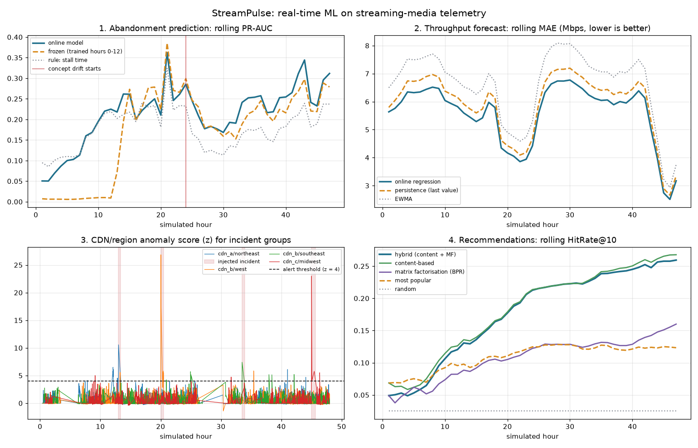

# StreamPulse: Real-Time ML on Video-Streaming Telemetry

StreamPulse is an end-to-end, real-time machine learning system for a video streaming
platform. It simulates the playback telemetry a streaming service collects (sessions,
30-second player heartbeats, bitrate, buffering, CDN routing), streams it through an
ingestion layer, and runs **five ML systems on the live stream**:

| # | Problem | ML type | Model | Baseline(s) |
|---|---|---|---|---|
| 1 | Will this viewer quit in the next ~60 s? | Supervised classification, delayed labels | Online logistic regression (SGD) | Frozen batch model, rule of thumb |
| 2 | What will this session's bandwidth be in 30 s? | Online regression / time series | Residual SGD regressor (Huber loss) | Persistence, EWMA |
| 3 | Is a CDN in some region having an incident? | Unsupervised anomaly detection | Peer-adjusted EWMA z-score, Isolation Forest | – |
| 4 | What should this viewer watch next? | Recommender systems | BPR matrix factorisation, content-based, hybrid | Popularity, random |
| 5 | What kinds of viewers do we have? | Unsupervised clustering | Online MiniBatchKMeans | – |

Around these sit the production pieces: schema validation and a dead-letter queue,
event-time micro-batching, an online feature store, drift monitoring (Page-Hinkley and
PSI), a versioned model registry, and a REST serving API.

No real data is needed. The simulator generates realistic telemetry with hidden ground
truth (personas, injected CDN outages, a mid-run concept drift), so every model can be
measured honestly.

## Quick start

```bash
cd streaming_media_ml
pip install -r requirements.txt            # numpy, pandas, scikit-learn, matplotlib
python run.py                              # 48 simulated hours, ~35 s on a laptop
python serve.py --selftest                 # start the API, send example requests
python serve.py                            # serve on http://127.0.0.1:8000
python -m unittest discover tests          # 10 unit + integration tests
```

Useful options: `--hours 12` for a quick run, `--rate 2000` to replay at 2,000 events/s
like a live feed, `--tap outputs/telemetry.jsonl` to save the raw stream, and
`--drift-boost 2` to learn faster after a drift alarm.

## Architecture

```
 StreamingPlatformSimulator          QueueSource            MicroBatcher
 (viewers, titles, CDNs,   ──────►  (producer thread,  ──►  validate ──► 30 s event-time
  ABR player, buffering,             bounded queue,          │            tumbling windows
  incidents, drift)                  like Kafka)             └─► dead-letter queue
                                                                          │
                     ┌────────────────────────────────────────────────────┘
                     ▼
              FeatureStore (session state, viewer profiles, CDN×region aggregates)
                     │
   ┌─────────────┬───┴─────────┬──────────────┬───────────────┐
   ▼             ▼             ▼              ▼               ▼
 Abandonment   Forecast     Anomaly       Recommender     Segmentation
 (delayed      (next 30 s   (z-score +    (BPR-MF,        (MiniBatch
  labels)       bandwidth)   IForest)      content, hybrid) KMeans)
   │             │                            │
   └─────────────┴──── ModelRegistry (versions + metadata, LATEST) ──► serve.py (REST API)
                       Monitoring: Page-Hinkley drift, PSI, rolling metrics ──► dashboard.png
```

## Project layout

```
streaming_media_ml/
├── run.py                     # run the whole system, print summary, save outputs
├── serve.py                   # REST API: /health, /v1/abandonment, /v1/forecast, /v1/recommendations
├── streampulse/
│   ├── config.py              # regions, devices, CDNs, genres, personas, incidents, drift time
│   ├── simulator.py           # synthetic streaming telemetry generator
│   ├── ingest.py              # queue source, schema validation, DLQ, event-time micro-batching
│   ├── feature_store.py       # online state + feature computation (shared by training & serving)
│   ├── monitoring.py          # Page-Hinkley, PSI, rolling metric windows
│   ├── registry.py            # versioned model registry
│   ├── pipeline.py            # orchestrates everything per 30 s window
│   ├── report.py              # dashboard figure
│   └── tasks/
│       ├── models.py          # online classifier/regressor wrappers, residual forecaster
│       ├── abandonment.py     # task 1
│       ├── forecasting.py     # task 2
│       ├── anomaly.py         # task 3
│       ├── recommender.py     # task 4
│       └── segmentation.py    # task 5
├── tests/test_streampulse.py
└── docs/INTERVIEW_GUIDE.md    # concepts, design decisions, Q&A, how to present it
```

## Results (48 simulated hours, seed 7)

373,042 events (6,823 sessions, 359,473 heartbeats) processed in 33 s, about
**11,000 events/s** on a laptop. 376 malformed events were caught and routed to the DLQ.

**1. Abandonment prediction** (2.2% positive rate)

| Scorer | ROC-AUC | PR-AUC |
|---|---|---|
| Online model | **0.880** | **0.281** |
| Frozen model (trained on hours 0–12) | 0.804 | 0.239 |
| Rule: "stalling now" | 0.642 | 0.194 |

At hour 24 the simulated audience changes (viewers start quitting on visible quality
drops). Page-Hinkley flagged the drift at hour 24.8. After the drift, the online model
averages 0.845 ROC-AUC against the frozen model's 0.789.

**2. Throughput forecast (30 s ahead):** MAE **4.03 Mbps** against 4.26 for persistence and
4.76 for EWMA (RMSE 7.90 against 8.21 and 9.23).

**3. CDN incident detection:** both detectors caught 3 of 4 injected incidents within one
window (30 s). Over 48 hours the z-score detector raised 11 false alerts and Isolation
Forest raised 7.

**4. Recommendations (HitRate@10)**

| Model | HitRate@10 | NDCG@10 |
|---|---|---|
| Content-based | **0.268** | **0.141** |
| Hybrid | 0.260 | 0.137 |
| Matrix factorisation (BPR) | 0.167 | 0.090 |
| Popularity | 0.126 | 0.062 |
| Random | 0.025 | – |

**5. Segmentation:** 973 viewers were clustered into 4 segments with an adjusted Rand
index of **0.975** against the hidden personas (silhouette 0.35). The segments come out as
"news + documentary, mornings", "kids + comedy, afternoons", "sports, evenings" and
"drama + action, evenings".

`outputs/dashboard.png` plots all of this over time:



## Known limitations

These are honest findings from building it. `docs/INTERVIEW_GUIDE.md` explains each one.

- One incident was missed: viewers left so fast that the CDN/region group fell below the
  minimum stream count. A "traffic suddenly vanished" signal would catch it.
- Weighting positives 5× improves ranking but makes the probabilities over-confident
  (worse Brier score). Calibration (Platt or isotonic) would fix this before using the
  probability as a business threshold.
- PSI uses the first ~3 hours (night-time) as its reference, so it mostly measures the
  daily cycle. A same-hour-yesterday reference would isolate real drift.
- Matrix factorisation is limited by sparse data (about 7 sessions per viewer). Content
  features win until there is more history.
- The data is synthetic. The pipeline design carries over to real telemetry, but the
  numbers above describe the simulator, not a real platform.
