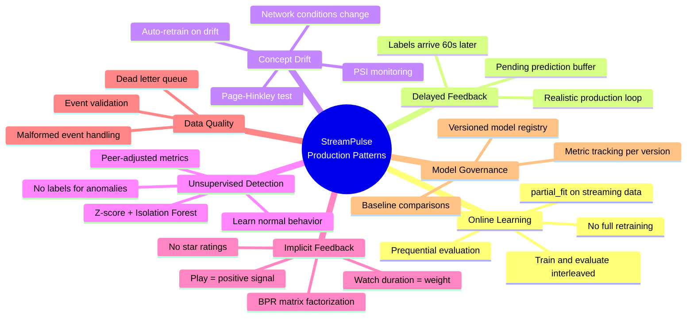
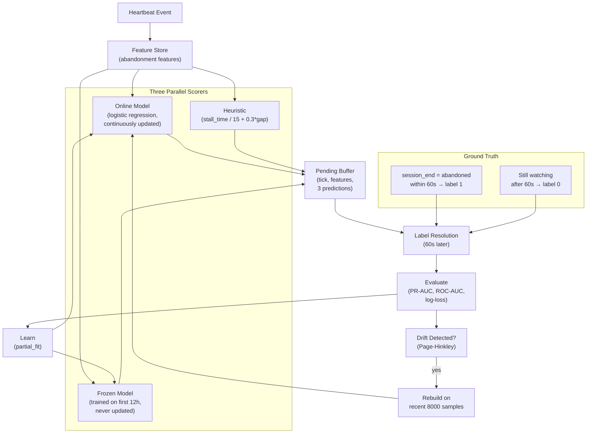
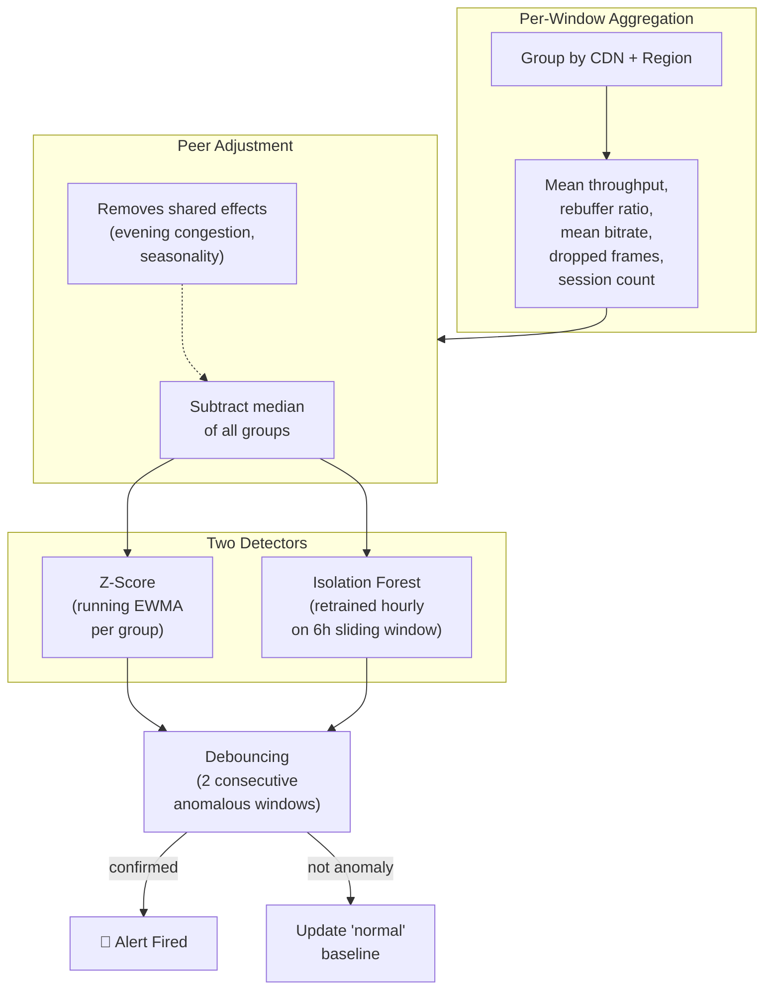

# StreamPulse — Architecture Diagram

## High-Level System Overview

```mermaid
flowchart TB
    subgraph SIM["📺 Streaming Platform Simulator"]
        V["2,000 Viewers\n(hidden personas)"]
        T["400 Titles\n(Zipf popularity)"]
        D["Daily Traffic Pattern\n+ Evening Congestion"]
        I["Injected CDN Incidents\n+ Concept Drift"]
    end

    subgraph EVENTS["Telemetry Events (every 30 s)"]
        E1["session_start"]
        E2["heartbeat\n(bitrate, throughput,\nbuffer, stalls)"]
        E3["session_end\n(completed / left /\nabandoned)"]
    end

    subgraph INGEST["📥 Ingestion Layer"]
        VAL["Event Validation"]
        MB["Micro-Batcher\n(30s windows)"]
        DLQ["Dead Letter Queue\n(malformed events)"]
    end

    subgraph FS["🗄️ Feature Store"]
        VF["Viewer Features"]
        SF["Session Features"]
        GF["CDN/Region Aggregates"]
    end

    SIM --> EVENTS
    EVENTS --> VAL
    VAL -->|valid| MB
    VAL -->|invalid| DLQ
    MB --> FS

    subgraph PIPELINE["⚙️ StreamPulse Pipeline (per 30s micro-batch)"]

        subgraph T1["Task 1: Abandonment Prediction"]
            A1["Online Logistic Regression\n(partial_fit)"]
            A2["Frozen Baseline Model\n(trained once)"]
            A3["Heuristic Baseline\n(stall-based rule)"]
            DD["Drift Detection\n(Page-Hinkley + PSI)"]
            DL["Delayed Labels\n(60s horizon)"]
        end

        subgraph T2["Task 2: Throughput Forecasting"]
            F1["Online Regression\n(lag features + EWMA)"]
            F2["Baselines:\npersistence & EWMA"]
        end

        subgraph T3["Task 3: Anomaly Detection"]
            AN1["Z-Score Detector\n(peer-adjusted EWMA)"]
            AN2["Isolation Forest\n(sliding-window retrain)"]
            AN3["Debouncing\n(2 consecutive windows)"]
        end

        subgraph T4["Task 4: Recommendations"]
            R1["Matrix Factorization\n(BPR optimization)"]
            R2["Baselines:\npopularity & random"]
            R3["Cold Start Handling"]
        end

        subgraph T5["Task 5: Viewer Segmentation"]
            S1["MiniBatch K-Means\n(partial_fit)"]
            S2["Behavior Profiles\n(genre, time, watch length)"]
            S3["Updated every 2 hours"]
        end
    end

    subgraph OUTPUTS["📊 Outputs & Monitoring"]
        REG["Model Registry\n(versioned models + metrics)"]
        DASH["Dashboard\n(dashboard.png)"]
        METRICS["Hourly Metrics\n(hourly_metrics.csv)"]
        ALERTS["Anomaly Alerts\n(alerts.json)"]
        SUMMARY["Full Summary\n(summary.json)"]
    end

    FS --> T1
    FS --> T2
    FS --> T3
    MB --> T4
    MB --> T5

    T1 -->|models + metrics| REG
    T2 -->|models + metrics| REG
    T3 --> ALERTS
    T1 --> METRICS
    T2 --> METRICS
    T4 --> METRICS
    T5 --> METRICS
    METRICS --> DASH
    T1 --> SUMMARY
    T2 --> SUMMARY
    T3 --> SUMMARY
    T4 --> SUMMARY
    T5 --> SUMMARY
    DD -->|drift detected| A1
    DL -->|resolved labels| A1
```

---

## Data Flow — Step by Step (per 30-Second Window)

```mermaid
flowchart LR
    A["1. session_start events\n→ Feature store, recommender,\nsegmentation profiles"]
    B["2. heartbeat events\n→ Feature store →\nCDN/region aggregates"]
    C["3. Abandonment scoring\n→ Score every heartbeat\n(labels arrive later)"]
    D["4. Forecasting\n→ Check last window's\nforecasts, learn, predict next"]
    E["5. Anomaly detection\n→ Score each CDN/region\naggregate"]
    F["6. session_end events\n→ Resolve abandonment labels,\nrecommender feedback,\nviewer profiles"]
    G["7. Label timeouts\n→ Heartbeats still watching\nafter 60s → label 0"]
    H["8. Housekeeping\n→ Clustering refresh,\nhourly metrics,\nmodel registry publish"]

    A --> B --> C --> D --> E --> F --> G --> H
```

---

## Key Production ML Patterns (Interview Talking Points)

---

## Abandonment Task — Deep Dive

---

## Anomaly Detection — Deep Dive

---

## Technology Stack

| Component | Technology |
|-----------|-----------|
| Language | Python 3.10+ |
| ML Models | NumPy (from scratch), Scikit-learn |
| Online Learning | Custom `partial_fit` implementations |
| Anomaly Detection | Z-score (custom) + Isolation Forest (sklearn) |
| Clustering | MiniBatch K-Means (sklearn) |
| Recommendations | Matrix Factorization with BPR (custom) |
| Drift Detection | Page-Hinkley test, PSI (custom) |
| Data | Pandas, NumPy |
| Visualization | Matplotlib/Seaborn |

---

## Why This Architecture Stands Out

1. **True online learning** — Models update incrementally via `partial_fit`, no batch retraining pipelines
2. **Prequential evaluation** — Evaluate-then-learn pattern mirrors real production, not train/test split
3. **Delayed label handling** — 60-second label delay with pending buffer reflects real-world feedback loops
4. **Concept drift adaptation** — Automatic drift detection and model rebuild when data distribution shifts
5. **Multiple baselines** — Every task compared against simple baselines (frozen model, persistence, popularity, heuristic)
6. **Unsupervised + supervised** — Mix of labeled (abandonment, forecasting) and unlabeled (anomaly, segmentation) tasks
7. **Production data quality** — Event validation, dead-letter queue, malformed event handling
8. **Model governance** — Versioned registry with per-version metric tracking
